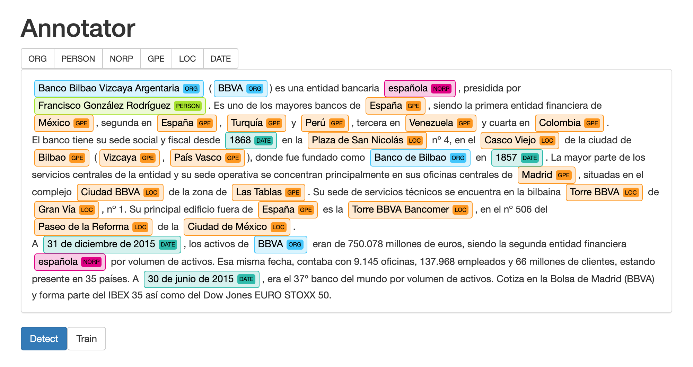

# spaCy Annotator

> This project is no longer maintained and the repository is archived. See [Status and history](#status-and-history).

A web application for annotating text corpora with [spaCy](https://spacy.io) named entity annotations, the labelled spans of text a model learns to find: ORG (organisations), PERSON, NORP (nationalities and religious or political groups), GPE (countries, cities and states), LOC (other locations) and DATE.

It was a 2017 prototype for exploring how a person and a model work together on the same text: tag entities by hand, send them to a server to train a model, and ask the server to detect entities again.

Select text in the editor and tag it with one of the entity types; tagged text is highlighted and labelled with its type. **Detect** posts the paragraphs to an `/ent` endpoint and loads the entities it returns into the editor, and **Train** posts the paragraphs and their tags to a `/train` endpoint. The app does not run spaCy itself: both endpoints are expected on a separate server at `http://127.0.0.1:8000`. That server is the trainable displaCy ENT server I contributed to Explosion's [spacy-dev-resources](https://github.com/explosion/spacy-dev-resources/tree/32fe013ec455a0949b347231ef9a9b006e3f8aa3/training/displacy_ent) in January and February 2017 ([#5](https://github.com/explosion/spacy-dev-resources/pull/5), [#8](https://github.com/explosion/spacy-dev-resources/pull/8)). It was built for spaCy 1.x, and has since been removed from that repository, which is archived, so the link is to the version this app was built against.

## Getting started

* Install:
    * [Node.js](http://nodejs.org) (if you don't have it): `brew install node` on OS X
    * [Brunch](http://brunch.io), its plugins and app dependencies: `npm install`. Don't install Brunch globally: from version 5 the `brunch` package on npm is an unrelated project.
* Run:
    * `npm start` — runs `brunch watch --server`, which watches the project with continuous rebuild. This will also launch HTTP server with [pushState](https://developer.mozilla.org/en-US/docs/Web/Guide/API/DOM/Manipulating_the_browser_history).
    * `npm run prod` — runs `brunch build --production`, which builds minified project for production
* Test:
    * `npm test` — executes test suites

## How it's built

* React components, with Redux and react-redux for state. The single route is set up with react-router and react-router-redux.
* The editor is Slate. Each entity type is a Slate mark, and `app/util/` converts between Slate's document format and the paragraphs sent to and received from the server.
* redux-saga runs the Detect and Train requests, which are made with `fetch` (isomorphic-fetch).
* Bootstrap provides the base styles; the entity highlight styles are in `app/styles/application.css`.
* Brunch builds `app/` into `public/`, compiling with Babel and copying static files from `app/assets/`.
* Tests run on Jest, with redux-saga-test-plan for the sagas.

## Status and history

This project is no longer maintained, and the repository is archived.

I wrote it between January and May 2017, when spaCy 1.x was current, and it did not get past the prototype stage: the entity types, the model name (`es`) and the server address are fixed in the code, the sample text is built in, and the server lived in a separate repository.

I stopped work on it in May 2017 because of other commitments. My interest was in how a person and a model work together on the same text; the model's accuracy came second. If I built it again, I would start with a stub server standing in for the model, so that the interaction could be tried on its own, and I would design for throughput: a queue of small decisions made from the keyboard, in place of one document tagged with the mouse. The same design question is open again with language models: how a person reviews, corrects and steers what a model produces.

This prototype predates [Prodigy](https://prodi.gy), the annotation tool that Explosion, the makers of spaCy, [announced in August 2017](https://explosion.ai/blog/prodigy-annotation-tool-active-learning). Prodigy is a separate project and does far more. To annotate data for spaCy today, look at Prodigy or another maintained tool.

The entity highlight styles in `app/styles/application.css` come from [displaCy ENT](https://github.com/explosion/displacy-ent), Explosion's entity visualiser, and the font files in `app/assets/fonts/` come from [Bootstrap](https://github.com/twbs/bootstrap). Both are under the MIT License. The Spanish sample text in `app/reducers/editor.js` comes from the [Spanish Wikipedia article on BBVA](https://es.wikipedia.org/w/index.php?oldid=95972782) as it stood in January 2017, and is under CC BY-SA 3.0, not the MIT License. The notices for all three are in [THIRD-PARTY-NOTICES.md](THIRD-PARTY-NOTICES.md).

In November 2026 the app still built and its tests passed on Node 24; the commands and results are recorded in [pull request 3](https://github.com/tcrossland/spacy-annotator/pull/3). Its dependencies date from 2017 and have known vulnerabilities, so run it locally only.
